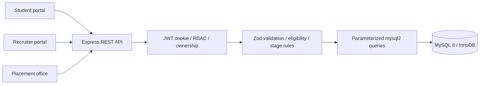
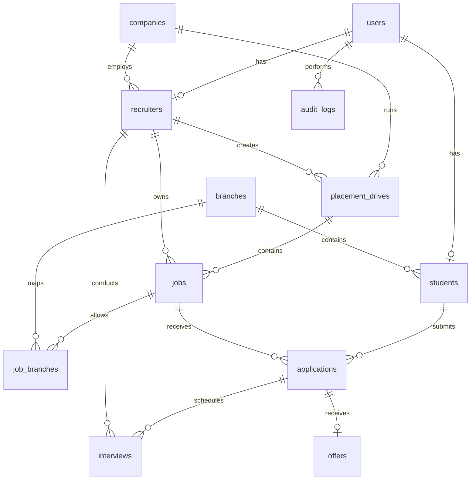

# SEEK project details

## Purpose and scope

SEEK centralizes a college's recruitment process: student academic profiles, recruiter onboarding, jobs, eligibility, applications, interviews, offers, and placement reporting. Three roles share one relational database through an Express API. The frontend never connects directly to MySQL.

The implementation preserves the requested React/Vite/TypeScript and Express/MySQL stack. It is locally runnable and is not deployed to Sites. The backend keeps its HTTP handlers in one router module, validation in `validators.ts`, pure business rules in `domain.ts`, and reusable SQL/transaction helpers in `database/connection.ts`. This deliberately compact organization differs from the plan's suggested one-directory-per-layer layout; all queries remain parameterized.

## Architecture

React Router provides separate portal routes. Vite proxies `/api` in development; Express serves the built React app in the single-port configuration. Authentication is a one-hour JWT in an HttpOnly, SameSite=Lax cookie. Production mode adds Secure. Every authenticated request rechecks account status and token version against MySQL. Logout increments the version to revoke existing tokens. Writes require an allowed Origin. API responses are not cached. HTML rendering escapes user-supplied text; resume and company URL input is limited to HTTP(S).

## Relational design

| Table            | Candidate keys / relationships     | Purpose                                            |
| ---------------- | ---------------------------------- | -------------------------------------------------- |
| users            | id; email                          | Password hash, role, status and revocation version |
| students         | id; user_id; enrollment            | Academic data, contact, resume link                |
| recruiters       | id; user_id                        | Company membership and designation                 |
| companies        | id                                 | Company details; name is not assumed unique        |
| branches         | id; code; name                     | Academic discipline                                |
| placement_drives | id; company/recruiter foreign keys | Recruitment season or event                        |
| jobs             | id; drive/recruiter foreign keys   | Role, pay, deadlines and criteria                  |
| job_branches     | (job_id, branch_id)                | Many-to-many eligibility mapping                   |
| applications     | id; (student_id, job_id)           | Current recruitment stage                          |
| interviews       | id; (application_id, round_number) | Multiple rounds with schedule and feedback         |
| offers           | id; application_id                 | One offer per application                          |
| audit_logs       | id; actor_user_id foreign key      | Append-only application-level activity history     |

All twelve tables use InnoDB. Foreign keys use restrictive default deletion behavior: historical records are preserved. Accounts are suspended and jobs/drives closed instead of deleting recruitment history. The application can replace job-branch mappings only before a job receives applications.

Checks enforce CGPA between 0 and 10, nonnegative ordered CTC, valid drive date order, and positive interview rounds. Unique constraints prevent duplicate emails, enrollments, applications, branch mappings, interview rounds and offers. Foreign-key indexes support joins; explicit indexes cover job status/deadline, application status, interview date and audit actor/date.

## Normalization analysis

For each entity table, its surrogate id determines all remaining attributes. Alternate keys in users, students, recruiters, branches, applications, interviews and offers determine the same complete row. The only composite-key-only table, job_branches, has no non-key attributes, so it cannot contain a partial dependency. All scalar fields contain one value; repeated interviews, applications, and eligible branches are separate rows. This supports 1NF and 2NF.

Company names and branch descriptions are not copied into student/job/application rows. Authentication attributes are separated from role profiles. This removes the main transitive dependencies and supports 3NF **under the implemented ownership model**, where the job owner is a distinct authorization relationship that can, in principle, differ from the drive creator. At present the API requires creators to own the parent drive. If ownership is permanently defined as inherited from the drive, `jobs.created_by_recruiter_id` becomes derivable and should be removed to maintain strict 3NF. Likewise an interview's recruiter is currently constrained to the job owner but is modeled as the assigned interviewer. This is an explicit design qualification, not an unconditional claim that splitting tables proves 3NF.

## Business rules and transactions

- Students must have a resume URL and satisfy CGPA, backlogs, branch and graduation-year criteria. Jobs must be published, belong to an active drive, and have a future deadline. A previous application (including a withdrawn one) blocks reapplication. A student with an accepted offer cannot apply again.
- Application submission locks the student and job rows, recomputes eligibility, inserts the application, and appends an audit event in one transaction. The unique pair constraint is a second concurrency guard.
- Allowed stages: applied → shortlisted/rejected; shortlisted → interview/selected/rejected; interview → selected/rejected. Creating an offer moves selected → offered in the same transaction. Students may withdraw while applied/shortlisted/interview. Rejection or withdrawal cancels scheduled rounds.
- Interview creation locks the application, checks ownership/stage, inserts a unique round and updates the stage atomically. Existing interviews can be rescheduled, completed with feedback, or cancelled.
- Offers can be created only for selected applications. Response deadlines are enforced. Acceptance locks the student to serialize competing acceptances and enforces one accepted offer per student.
- Jobs with applications cannot have their terms rewritten. They can be closed, preserving history; a replacement role can be posted.
- Transaction helper rolls back on any error and retries MySQL deadlocks up to two times. It always releases its connection.

## Analytics definitions

Placed students are distinct students with **accepted** offers. Placement percentage is placed students / all registered students, including suspended profiles. Branch percentages use the same definition within each branch. Published-job counts exclude past deadlines. CTC minimum, average, median and maximum use accepted offers only; empty salary datasets display a dash. Company participation uses LEFT JOIN so companies with no jobs or applicants are retained. CSV export includes branch counts and uses formula-injection protection.

## API map

| Area           | Routes                                                                                                                                            |
| -------------- | ------------------------------------------------------------------------------------------------------------------------------------------------- |
| Auth           | POST /api/auth/register, /login, /logout; GET /api/me                                                                                             |
| Student        | PUT /api/profile; POST /api/jobs/:id/apply                                                                                                        |
| Company        | PUT /api/company (recruiter's own company)                                                                                                        |
| Jobs           | GET /api/jobs, /api/jobs/:id; POST /api/jobs; PUT/PATCH /api/jobs/:id                                                                             |
| Drives         | GET/POST /api/drives; PUT/PATCH /api/drives/:id                                                                                                   |
| Applications   | GET /api/applications; PATCH /api/applications/:id                                                                                                |
| Interviews     | GET/POST /api/interviews; PATCH /api/interviews/:id                                                                                               |
| Offers         | GET/POST /api/offers; PATCH /api/offers/:id                                                                                                       |
| Administration | GET /api/admin/analytics, /recruiters, /students, /companies, /audit; PATCH /api/admin/recruiters/:id and /students/:id; POST /api/admin/branches |
| Public         | GET /api/health, /api/branches, /api/public                                                                                                       |

## Limitations and deliberate boundaries

This is an academic v1, not a multi-university service. There is no password recovery, email verification, notifications, resume file hosting, AI ranking, payments or external HR integration. Student academic fields are self-declared; a real campus should establish verification/approval before using them for decisions. Audit rows are append-only through the API but a privileged database administrator can change them. Lists load the local dataset as a whole (audit is capped at 500); larger deployments need pagination and aggregate query optimization. Auth rate limiting is process-local. There is no full administrator-account management screen; creation uses a controlled CLI. Company editing belongs to its recruiter; admin companies are an oversight list. Branches can be added but not deleted through the app. No production email, backups, load test, independent penetration test, or MySQL Workbench screenshots are claimed.
